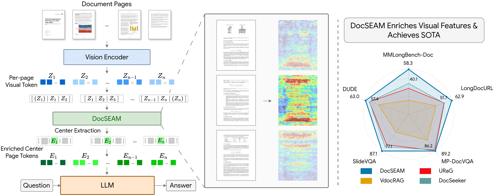
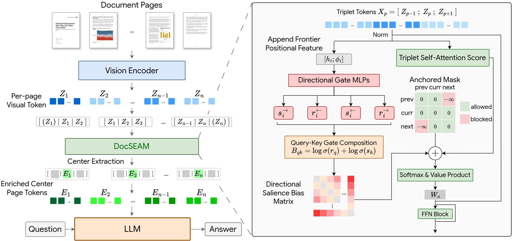
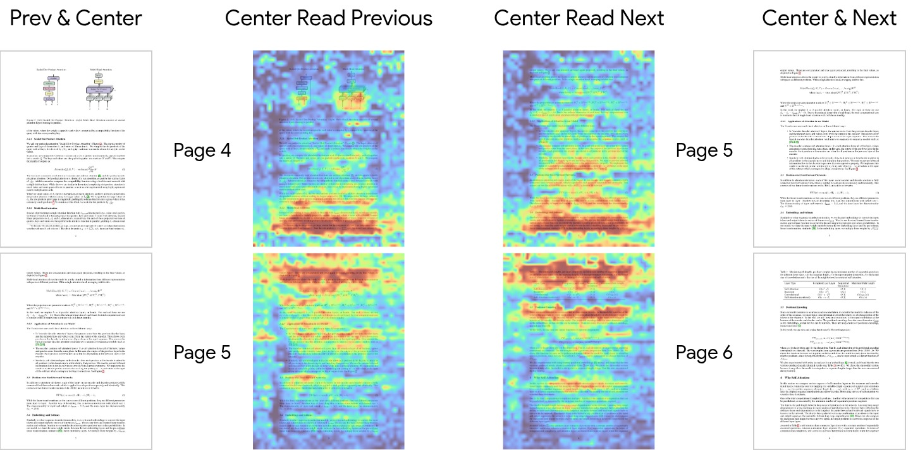

<div align="center">
  <h2>DocSEAM: Bidirectional Cross-Page Encoding for Multi-Page Document Understanding</h2>
  <p>
    <a href="https://mossbee.github.io/">Hoang-Nhat Nguyen</a><sup>1</sup> &nbsp;·&nbsp;
    <a href="https://www.mmlab-ntu.com/person/ccloy/">Chen Change Loy</a><sup>1,2</sup>
  </p>
  <p>
    <sup>1</sup>S-Lab, Nanyang Technological University &nbsp;·&nbsp; <sup>2</sup><a href="https://synvo.ai/">Synvo AI</a>
  </p>
  <p>
    <a href="https://mossbee.github.io/projects/DocSEAM/"></a>
    <a href="https://arxiv.org/abs/2611.34420"></a>
    <a href="https://huggingface.co/mossbee/DocSEAM"></a>
    <a href="https://github.com/mossbee/DocSEAM"></a>
  </p>
</div>

<p align="center"><strong>DocSEAM enriches visual features with context from neighboring pages for multi-page document understanding.</strong></p>

<p align="center">
  
</p>

<details>
<summary><b>Introducing DocSEAM</b></summary>

<p>DocSEAM enriches each page's visual features with information from its immediate neighbors through center-anchored masked attention and directional salience gates. It preserves the visual token count passed to the language model.</p>
<p>The architecture below details the directional gates and anchored attention mask used to enrich the center page.</p>
<p align="center">
  
</p>

</details>

## Installation

Use Python 3.11 and a CUDA-enabled PyTorch installation.

```bash
git clone https://github.com/mossbee/DocSEAM.git
cd DocSEAM
pip install -r requirements.txt
```

## Inference

Load the model from `mossbee/DocSEAM` on Hugging Face, or pass a local model directory with `--model /path/to/DocSEAM`.

```bash
python infer.py --model mossbee/DocSEAM \
  --images examples/attention/1706.03762v7_page-0004.jpg \
           examples/attention/1706.03762v7_page-0005.jpg \
           examples/attention/1706.03762v7_page-0006.jpg \
  --question "How many parallel attention heads are used in the model? Answer with only the number." \
  --max-new-tokens 128
```

The example uses pages 4-6 of *Attention Is All You Need*. Pass page images in document order.

## Benchmark inference

The `benchmarks/` directory contains test manifests for DUDE, MP-DocVQA, SlideVQA, LongDocURL, and MMLongBench-Doc. Obtain the benchmark page images and preserve the filenames referenced by the manifests.

Organize the image directories under a common root.

```text
datasets/
├── dude/images/test/...
├── mp_docvqa/images/...
├── slidevqa/imgs/...
├── longdocurl/imgs/...
└── mmlongbench_doc/data/imgs/...
```

Image paths in the manifests are relative to `--image-root`.

```bash
python inference_benchmarks.py --model mossbee/DocSEAM --image-root /path/to/datasets --benchmark dude
```

Replace `dude` with `mp_docvqa`, `slidevqa`, `longdocurl`, or `mmlongbench_doc`. Use `--output-file` to choose an output path. Generation limits default to 512 tokens for DUDE, 256 for MP-DocVQA and SlideVQA, and 2,048 for LongDocURL and MMLongBench-Doc. Override them with `--max-new-tokens`.

For DUDE and MP-DocVQA, the script writes submission-ready JSON directly to `results/dude.json` or `results/mp_docvqa.json`. Upload the generated file to the corresponding task on the [RRC evaluation portal](https://rrc.cvc.uab.es/). You can also upload the included [DUDE](submissions/dude.json) and [MP-DocVQA](submissions/mp_docvqa.json) prediction files.

For SlideVQA, LongDocURL, and MMLongBench-Doc, the script writes `results/<benchmark>.jsonl`, preserving each manifest row and adding the generated answer in `qwen_answer`.

## Directional gate visualization

Visualize the directional salience gates for the bundled pages 4–6.

```bash
python visualize_attention.py --model mossbee/DocSEAM \
  --output results/directional_heatmap.png
```

The figure shows the previous page sending to the center, the center receiving from each neighbor, and the next page sending to the center. Gate scores are averaged across the two DocSEAM layers using a shared color scale. Numeric statistics are saved beside the PNG.

Pass `--images previous.jpg center.jpg next.jpg --first-page 4` to visualize another ordered triplet. To reproduce the visualization:

```bash
python visualize_attention.py --model mossbee/DocSEAM \
  --vision-model Qwen/Qwen3.5-9B --position-feature-mode physical \
  --output results/stage_a_directional_heatmap.png
```

<p align="center">
  
</p>

## License

DocSEAM is released under the [S-Lab License 1.0](LICENSE) for non-commercial use. It builds on Qwen3.5-9B, whose Apache-2.0 license is retained in [LICENSE-QWEN](LICENSE-QWEN).

## Citation

```bibtex
@article{nguyen2026docseam,
  title={DocSEAM: Bidirectional Cross-Page Encoding for Multi-Page Document Understanding},
  author={Nguyen, Hoang-Nhat and Loy, Chen Change},
  journal={arXiv preprint arXiv:2611.34420},
  year={2026},
}
```
